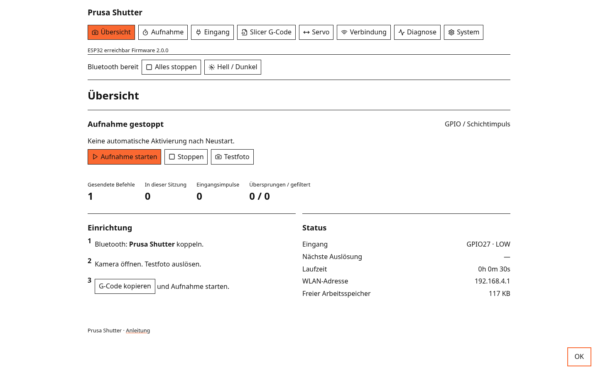
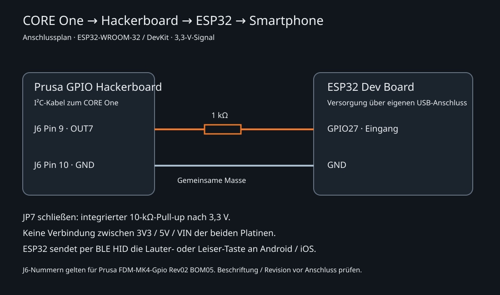

# Prusa Shutter 2

**CORE One + Prusa GPIO Hackerboard + ESP32-WROOM-32**: Bluetooth-Fotoauslöser für Android und iOS mit lokalem Dashboard, visuellem PrusaSlicer-Konfigurator und optionalem 270°-Servo.



## Was ist neu?

| Bereich | Möglichkeiten |
|---|---|
| Fotos | Lauter, Leiser oder abwechselnd; manueller Test; GPIO- und Intervallmodus |
| Aufnahmeprogramme | Jede n-te Schicht, Verzögerung, 1–50 Befehle pro Serie, Serienabstand, Countdown |
| Grenzen | Mindestabstand, Tastendauer, Sitzungsgrenze, zeitgesteuerter Stopp |
| Eingang | GPIO-Auswahl, HIGH/LOW-Auslösung, Entprellung, interner Pull-up, Verhalten bei BLE-Ausfall |
| G-Code-Konfigurator | Kamera/Servo anklicken, Servo-Winkel und Ereignisse wählen, Start-/Schicht-/End-Code kopieren oder herunterladen |
| Servo | 180°/270°-Zuordnung, PWM-Pulsgrenzen, Signaländerungsrate, manuelle Positionen, acht gespeicherte Aktionen |
| Verbindungen | Eigenes WPA2-WLAN, zusätzlich Router-WLAN, mDNS, eigene Geräte-/Bluetooth-Namen und Passwörter |
| Diagnose | HID-Bereitschaft, Eingangspegel, Zähler, Heap/Flash/WLAN, 48 Ereignisse, Diagnose-Export |
| Verwaltung | Foto-Einstellungen importieren/exportieren, Kopplungen löschen, Foto-Reset, Neustart, authentifiziertes WLAN-Update |
| Oberfläche | Schlichtes HTML, wenig CSS, Lucide-SVGs, Orange/Schwarz/Weiß, Mobil/Desktop, Hell/Dunkel |
| Installation | Einfache HTML-Flashseite mit ESP Web Tools, passendem ESP32-Image und Prüfsummen |

Die Firmware sendet Tastenbefehle, keine Kamera-API-Aufträge. Die Kamera-App muss geöffnet sein und Lautstärketasten als Fotoauslöser unterstützen. Ein gesendeter Befehl ist keine Bestätigung für ein gespeichertes Foto.

## Installation in wenigen Schritten

Die veröffentlichte Flashseite: **https://leotrax3d.github.io/prusa-gpio-ble-shutter/**

1. Klassisches **ESP32-WROOM-32 / DevKit mit mindestens 4 MB Flash** über USB-Datenkabel an Desktop-Chrome oder Edge anschließen. Drucker-/Servoleitungen zunächst trennen.
2. Die bereitgestellte Flashseite öffnen und **ESP32 installieren** wählen. Die Website liegt als schlichte HTML-Datei in [`site/index.html`](site/index.html); Hosting benötigt HTTPS, lokal genügt localhost.
3. Beim ersten Umstieg von Version 1 auf 2 **Gerät löschen / Erase device** wählen: Version 2 verwendet eine neue Partitionstabelle mit zwei OTA-Slots. Einstellungen und BLE-Kopplungen vorher sichern bzw. anschließend neu einrichten.
4. Nach Installation im ESP-Web-Tools-Dialog **Logs & Console** öffnen, 115200 Baud, Board mit EN/RESET neu starten. Dort stehen WLAN- und Dashboard-Passwort.
5. WLAN **Prusa-Shutter** verbinden, „kein Internet“ akzeptieren, **http://192.168.4.1** öffnen. Benutzer **admin**, individuell erzeugtes Passwort aus dem seriellen Protokoll.
6. Smartphone mit **Prusa Shutter** in den Bluetooth-Einstellungen koppeln. Kamera öffnen und Testfoto prüfen. Erst danach Aufnahme aktivieren.

Android/iOS funktionieren als Kamera und für das Dashboard. Die USB-Installation benötigt einen Desktop-Browser mit Web Serial; Safari/Firefox/iOS eignen sich für diesen Installer nicht. Ein rein lokaler, nicht über localhost/HTTPS geöffneter HTML-Download genügt nicht.

### Selbst bauen / lokal flashen

```sh
pip install platformio==6.1.18
pio run
pio run --target upload
pio device monitor --baud 115200
python scripts/package_firmware.py
python -m http.server 8080 --directory site
```

Dann `http://localhost:8080` auf dem Rechner mit angeschlossenem ESP32 öffnen. `package_firmware.py` erzeugt `merged.bin` für USB, `firmware.bin` für OTA, Manifest und SHA-256-Prüfsummen. Die Dateien werden ebenfalls als GitHub-Actions-Artefakt gebaut. Die Flashseite enthält keine Benutzerpasswörter.

Plattform fixiert: espressif32 6.10.0 / Arduino-ESP32 2.0.17, ArduinoJson 7.3.1. `scripts/embed.py` komprimiert das Dashboard beim Build in PROGMEM; kein Dateisystem-Upload nötig. Firmware ist ausschließlich für das klassische ESP32 gebaut. C3/S3 benötigen eigene Builds; S2 hat kein Bluetooth.

## Ohne Löten: Fotoanschluss



| Hackerboard | ESP32 |
|---|---|
| OUT7 | GPIO27 (Standard) |
| GND | GND |

ESP32 separat per USB versorgen. **JP7 darf offen bleiben**, die Firmware nutzt `INPUT_PULLUP`. Ein zusätzlicher 1-kΩ-Serienwiderstand ist optional, für die normale 3,3-V-Verbindung nicht erforderlich. Ohne Löten braucht man montierte Stiftleisten oder zuverlässige passende Prüfkontakte. Lose Drähte in Lötlöchern sind ungeeignet.

Zum Verkabeln beide Geräte ausschalten. Keine Verbindung zwischen 3V3 / 5V / VIN der Platinen herstellen; GPIOs sind nicht 5-V-tolerant. Der Aufbau hat gemeinsame Masse und ist nicht galvanisch getrennt. Bei längerer einseitiger Versorgung die Signalleitung trennen, um Rückspeisung über Schutzdioden zu vermeiden.

Der [Originalschaltplan Rev02 BOM05](https://www.prusa3d.com/downloads/Electronics_drawings/FDM-MK4-Gpio-02-(BOM05).pdf) zeigt OUT4–7 direkt über 330 Ω am TCA6408A. OUT0–3 besitzen dagegen invertierende MOSFET-Stufen. Die pauschalen Open-Drain-Aussagen der Hilfeseite sind für OUT7 missverständlich. Standard: **B0 = LOW-Ruhepegel, B1 = HIGH-Auslösung**. Revision und gemessenen Pegel vor dem ersten Druck prüfen. Für Rev02 ist OUT7 J6/9, OUT6 J6/8, GND J6/10 oder J6/1.

```gcode
M264 P7 B0
M262 P7 B0
M264 P7 B0 ; Dashboard muss LOW zeigen
; einzeln pruefen:
M264 P7 B1 ; Dashboard muss HIGH zeigen
M264 P7 B0
```

Die Ausgabe `M264` bezeichnet den logischen Zustand am Expander. Keinen OUT0–3-Anschluss anstelle von OUT7 verwenden, ohne die elektrische Schaltung anzupassen.

## Visueller G-Code-Konfigurator

Im Dashboard **Slicer G-Code** öffnen:

1. **Kamera** und/oder **Servo** anklicken.
2. Foto-Einstellungen unter Aufnahme/Eingang speichern.
3. Für den Servo bis zu acht Aktionen hinzufügen: Winkel und **Druckstart**, **jede Schicht**, **bestimmter `layer_num`** oder **Druckende** wählen.
4. **G-Code-Steuerung über OUT6 zulassen**, Befehlseingang wählen, Aktionsplan im ESP32 speichern. Das schaltet das Servo-Signal aus.
5. Unter Servo die kalibrierten Grenzen prüfen und das Signal ausdrücklich freigeben. Keine Freigabe per G-Code und kein automatischer Start nach Neustart.
6. Die drei erzeugten Blöcke unter PrusaSlicer → Drucker → Benutzerdefinierter G-Code an das Ende von **Start G-Code**, **Nach dem Schichtwechsel**, **End G-Code** ergänzen. Vorhandene Inhalte beibehalten.
7. Neu slicen. Nach Änderungen an Winkeln, Aktionsreihenfolge, Polarität oder Timing immer erneut erzeugen und neu slicen.

Der Konfigurator benutzt **gespeicherte** Einstellungen. Nicht gespeicherte Änderungen werden angezeigt und verändern die aktiven G-Code-Blöcke nicht. `layer_num` wird als Slicer-Platzhalter direkt verglichen; gewünschten Index im erzeugten Druck-G-Code prüfen. Schichtbedingungen werden als `{if layer_num == ...}` / `{endif}` ausgegeben.

Keine Parkbewegungen und keine Änderung des Extrusions-/Koordinatenmodus. Der Kopf bleibt an der jeweiligen Schichtwechselposition. Foto-Code wartet konservativ auf Verzögerung, Serie, Kamera und Mindestabstand. Dadurch verlängert sich der Druck. Servo-Aktionen innerhalb desselben Ereignisses werden in Listenreihenfolge ausgeführt, danach folgt der Fotoimpuls.

Die Dateien in [`gcode/`](gcode/) sind fertige Foto-Standardvorlagen. Bei individuellen Einstellungen den Dashboard-Generator verwenden. End-/Abbruch-Code setzt Signale in Ruhe, stoppt aber weder das ESP32-Programm noch garantiert er eine mechanische Servo-Abschaltung. Nach dem Druck im Dashboard stoppen.

## Optionaler Miuzei-Servo, 270°

Zusätzlich zur Fotoverdrahtung:

| Verbindung | Zweck |
|---|---|
| ESP32 GPIO26 → Servo-Signalleitung | PWM mit 50 Hz, Standardpin einstellbar |
| Eigene geeignete Servo-Versorgung → Servo + / GND | Laut Nutzerbild 4,8–6,8 V; ausreichend für Anlauf-/Blockierstrom dimensionieren |
| Servo-Versorgungs-GND → ESP32-GND | Gemeinsame Signalreferenz |
| Hackerboard OUT6 → ESP32 GPIO33 | Zusätzlicher G-Code-Befehlseingang, einstellbar |

Servo-Leitungsfarben/Steckerbelegung am konkreten Modell prüfen. Nie einen Servo aus einem Hackerboard- oder ESP32-GPIO speisen; niemals Servo-Versorgung an den Signalpin legen. Ob das konkrete Modell 3,3-V-Signale zuverlässig akzeptiert, muss geprüft werden. Falls nicht, wird zusätzliche Pegelanpassung benötigt. Mit passenden konfektionierten Leitungen/Adaptern ist ein Aufbau ohne Löten möglich.

Standardmäßig **Signal aus**, auch nach Neustart, Kalibrierungsspeicherung oder Firmware-Update. Keine Verbindung zum Drucker ist für manuelle Bewegung nötig. Kalibrierte Pulsgrenzen starten vorsichtig mit 1000–2000 µs; das garantiert nicht den vollen 270°-Weg. Der erweiterte Bereich 500–2500 µs ist eine einstellbare Softwaregrenze, keine Aussage zur Zulässigkeit für dieses Modell. Erst Herstellerangaben und freie Endlagen ohne Mechanik prüfen.

Winkel werden linear auf Pulsbreiten abgebildet; es gibt keine Positionsmessung. Die erste Bewegung nach Freigabe kann direkt zum Ziel springen. Spätere Bewegungen werden über die eingestellte Pulsänderung pro 20 ms angenähert. Der Generator addiert die maximale Signal-Rampenzeit aus Pulsbereich und Schrittweite automatisch zur zusätzlich einstellbaren Beruhigungszeit. Eine tatsächliche Positionsbestätigung gibt es nicht; die zusätzliche Zeit auf die Mechanik abstimmen. „Signal aus“ beendet PWM, trennt aber nicht die Stromversorgung und garantiert keine kraftfreie Mechanik. **Alles stoppen** stoppt Fotoaufnahme und Servo-PWM.

### OUT6-Befehlsprotokoll

Eigenes Protokoll dieser Firmware, keine native Servo-Funktion der Prusa-Firmware:

- Ruhe: OUT6 LOW mindestens 300 ms.
- Aktion 1–8: OUT6 HIGH für `Aktionsnummer × 200 ms` (200–1600 ms), dann LOW.
- Empfänger entprellt mit 20 ms und akzeptiert Pulsbreiten mit ±70 ms Toleranz. Ausführung nach 30 ms stabilem LOW.
- Start bei HIGH, zu lange oder unpassende Pulse lösen keine Aktion aus. Vor dem nächsten Befehl wieder mindestens 300 ms LOW.
- Ein gültiger Slot führt nur bei aktivierter Automation **und manuell freigegebenem Servo-Signal** zur gespeicherten Zielposition.

Der Generator erzeugt dieses Protokoll automatisch. OUT6 nicht gleichzeitig anderweitig verwenden. Keine bestätigte Übertragung oder Positionsrückmeldung; bei verlorenen/verzögerten Signalen kann eine Aktion ausbleiben. Vor Nutzung im Druck alle Aktionen einzeln prüfen. Der Aktionsplan muss exakt zum geslicten G-Code passen.

## Verhalten und Architektur

Die Aufnahme-Engine und Servo-Auswertung laufen in einem eigenen FreeRTOS-Task. HTTP-Antworten und NVS-Schreibvorgänge werden außerhalb des Engine-Mutex ausgeführt; kurze Konfigurationswechsel sind synchronisiert. Tastenfreigabe wartet nicht auf einen `delay()` im Webserver. BLE-/Flash-Operationen und das ESP32-Betriebssystem erlauben trotzdem keine harte Echtzeitgarantie.

- BLE-Bereitschaft bedeutet Verbindung, erfolgreiche Verschlüsselung und aktivierte HID-Notifications. Das bestätigt keine Bereitschaft der Kamera-App.
- Jede n-te Aufnahme bedeutet Impuls 1, n+1, 2n+1 …; Neustart einer Sitzung beginnt neu zu zählen.
- Nur ein ausstehender Auftrag; keine unbegrenzte Warteschlange. Während Trennung oder Sperrzeit verworfene Impulse werden nicht nachgeholt.
- Bei BLE-Trennung wird eine ausstehende Serie verworfen. Standardmäßig wird zusätzlich die Aufnahme deaktiviert. Wird dieses Verhalten ausgeschaltet, bleibt das Programm aktiv, puffert aber keine Fotos.
- Neustart deaktiviert Aufnahme und Servo. Es gibt bewusst keine gespeicherte automatische Freigabe.
- Start bei bereits aktivem Eingang erzeugt kein Foto: erst stabiler Ruhepegel, dann aktive Flanke.
- Sitzungs-/Gesamtzähler und die letzten 48 Ereignisse liegen im RAM und werden beim Neustart gelöscht. Konfiguration liegt im NVS.
- „Gesendet“ zählt Notification-Versuche. „Gefiltert“ zählt durch jeden-n-ten-Impuls ausgelassene Signale; Impulszählung erfolgt im aktiven GPIO-Aufnahmemodus.
- Bei Verwendung beider Geräte betrifft „Aufnahme stoppen“ nur Fotos; **Alles stoppen** beendet auch Servo-PWM.

## Netzwerk, Passwort und Updates

Eigenes WPA2-WLAN bleibt aktiv, optional zusätzlich Router-WLAN. Bei AP+STA folgt der AP dem Router-Kanal. `hostname.local` benötigt mDNS-Unterstützung im Netzwerk; IP-Adresse steht im Dashboard und seriellen Status. Maximal vier AP-Clients. Keine Portfreigabe oder Cloud-Anbindung nötig.

Beim ersten Start erzeugt der ESP32 ein individuelles Passwort. WLAN- und Admin-Passwort lassen sich später unabhängig ändern; Änderungen gelten erst nach Neustart. Passwortfelder liefern gespeicherte Geheimnisse niemals an den Browser zurück. Lokale HTTP-Basic-Authentifizierung schützt API und Dashboard, `X-Shutter: 1` schützt POST-Routen gegen einfache fremde Formularaufrufe. Die HTTP-Verbindung selbst ist nicht TLS-verschlüsselt; nur in vertrauenswürdigem Netz verwenden, keine Internet-Portfreigabe einrichten. BLE verwendet Bonding mit Just Works; beim ersten Koppeln gibt es keine PIN-Prüfung.

OTA über System → **firmware.bin** auswählen. Upload benötigt Authentifizierung und POST-Header, stoppt Aufnahme/Servo und prüft ESP32-App-Header. `merged.bin`/Bootloader-Dateien werden abgelehnt. Firmware ist nicht kryptografisch signiert; nur vertrauenswürdige Projekt-Releases installieren. Für Version 1 → 2 ist USB wegen neuer Partitionierung erforderlich. Ein fehlgeschlagenes Update startet nicht automatisch neu; Fehleranzeige prüfen. Bei erfolgreichem Update erfolgt Neustart.

Foto-JSON-Export enthält keine Netzwerkgeheimnisse oder Servo-Kalibrierung. Die Diagnose enthält lokale IP und Ereignisse; vor Weitergabe prüfen. Vollständiges Löschen mit `pio run --target erase` entfernt Konfiguration und Kopplungen; danach neu flashen und alten Smartphone-Eintrag vergessen.

## Tests und Stand

```sh
g++ -std=c++11 -Iinclude test/trigger.cpp -o /tmp/trigger-test && /tmp/trigger-test
g++ -std=c++11 -Iinclude test/engine.cpp -o /tmp/engine-test && /tmp/engine-test
pio run
python scripts/package_firmware.py
pip install playwright==1.56.0
python -m playwright install chromium
python test/browser.py
```

[Prüfprotokoll](docs/validation.md). C++-Tests prüfen den tatsächlichen Aufnahme-Scheduler und den Servo-Protokolldecoder. Browserprüfungen simulieren Geräteantworten und das Installer-Element, prüfen also keine echte ESP32-HTTP-/BLE-/USB-Kommunikation. **Hardwaretests mit CORE One, ESP32, Smartphone und Servo stehen aus.** Vor einem langen Druck: Pegel prüfen, zehn Fotoimpulse testen, BLE trennen/neu verbinden, Neustartverhalten prüfen und Servo-Aktionen ohne Mechanik kontrollieren.

CI baut Firmware/Installer und führt C++- und Browsertests aus. GitHub Pages veröffentlicht den eingecheckten Installer inklusive Firmware-Dateien aus **main / (root)**. Die Startseite leitet nach `site/` weiter. Für ein neues Release zuerst die Firmware bauen, `scripts/package_firmware.py` ausführen und die aktualisierten Dateien unter `site/firmware/` mit dem dazugehörigen Quellcode committen. CI stellt zusätzlich ein Firmware-Artefakt bereit.

## Quellen

- [Prusa GPIO Module](https://help.prusa3d.com/article/gpio-module_734695)
- [Prusa Timelapse mit ESP32/Bluetooth](https://blog.prusa3d.com/create_3d_print_timelapses_using_prusa_gpio_hackerboard_117339/)
- [Originalschaltplan Rev02 BOM05](https://www.prusa3d.com/downloads/Electronics_drawings/FDM-MK4-Gpio-02-(BOM05).pdf)
- [Prusa-Firmware: M262–M268](https://github.com/prusa3d/Prusa-Firmware-Buddy/blob/master/src/marlin_stubs/M262-M268.cpp)
- [ESP Web Tools](https://esphome.github.io/esp-web-tools/)

Eigenständiges Community-Projekt, nicht von Prusa unterstützt. Eigener Code und Anschlussplan: MIT. Externe Unterlagen/Bibliotheken haben eigene Lizenzen. Lucide-SVGs 0.468.0: ISC, siehe `web/lucide-LICENSE`. ESP Web Tools und dessen Lizenzen liegen unter `site/vendor/`.
